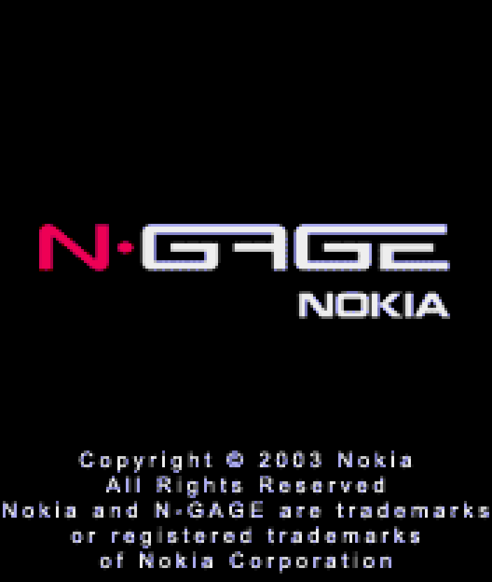

<p align="center">
  
</p>

<h1 align="center">Nokia N-Gage Core</h1>

<p align="center">
  Nokia N-Gage for MiSTer FPGA
</p>

---

## Overview

This core runs the real N-Gage firmware (NEM-4 V4.03) on the second ARM core of the DE10-Nano. The FPGA does the phone hardware: LCD, keypad, MMC card, sound, backlight and vibration. Games run from zip files of the MMC card, and the game files are not changed.

The core needs its own MiSTer main binary, `MiSTer_ngage`. Other cores stay on the stock main.

---

## Firmware

The firmware is not included. You need the two Nokia NEM-4 V4.03 service files:

| File | MD5 |
|------|-----|
| `nem440.3c1` | `90c1f921fd833c45a3c8434dd4fbd14b` |
| `nem440.326` | `ca1d2e809b2eced4fb2ebfabdc006563` |

Put them in `/media/fat/games/NGage/`. On the first start the core makes `base.rom` there, it takes about 5 seconds. The OSD shows `building base.rom`, then `base.rom ready`. After that you can delete the two files.

If the OSD shows `bad nem440.3c1` or `bad nem440.326`, the file has the wrong size or checksum. If it shows `wrong base.rom`, your `base.rom` was not made from these two files. Delete it, put the service files back and start agian. If it shows `cannot read base.rom, C: off`, the core found no `base.rom`, so put the service files back.

---

## Installation

1. Copy `releases/NGage_20261030.rbf` to `/media/fat/_Console/`.
2. Copy `releases/MiSTer_ngage` to `/media/fat/`.
3. Copy `releases/ngage_mon.bin` and `releases/ngage_patch.txt` to `/media/fat/games/NGage/`.
4. Copy `releases/Presets/N-Gage` to `/media/fat/Presets/` and `releases/Filters/N-Gage` to `/media/fat/Filters/`.
5. Add these lines to the end of `/media/fat/MiSTer.ini`:
```
[NGage]
main=MiSTer_ngage
```
6. Put the firmware files in `/media/fat/games/NGage/`.
7. Put game zips in `/media/fat/games/NGage/`. Subfolders wrok too. A zip holds what the game has on the root of the MMC card: the `system` folder and the other files.
8. Start N-Gage from the Console menu and pick `Load game` in the OSD.

The rbf, `MiSTer_ngage`, `ngage_mon.bin` and `ngage_patch.txt` go together, so allways update them as a set.

Some games need shared libraries that a real MMC card had in `System\Libs`, for exmaple Pathway to Glory. Put them in `/media/fat/games/NGage/System/Libs/` and the core adds them to the game card when the game needs them.

---

## Controls

Default gamepad mapping:

| Gamepad | N-Gage |
|---------|--------|
| D-pad | Navigation |
| A / B / X / Y | 5 / 7 / 2 / 8 |
| L / R | Left / right soft key |
| Start | OK |
| Select | C |

You can map the other kyes in the OSD: green, red, 0, 1, 3, 4, 6, 9, * and #.

Keyboard:

| Keyboard | N-Gage |
|----------|--------|
| Arrows | Navigation |
| 0-9, numpad | Digits |
| `-` / `=` | * / # |
| Enter | OK |
| F1 / F2 | Left / right soft key |
| F3 / F4 | Green / red |
| Backspace | C |

---

## OSD Options

| Option | Values |
|--------|--------|
| Aspect ratio | Original, Full Screen, custom |
| Scale | Normal, V-Integer, Narrower HV-Integer, Wider HV-Integer |
| Orientation | Vert, Horz, Horz180 |
| Crop | On, Off |
| Real Backlight | Off, On (screen brightness follows the phone backlight) |
| LCD ghosting | Off, Phone |
| Turbo | Off (real phone speed), On (no speed limit) |
| Reset | Restarts the phone |

The phone clock follows the MiSTer time.

---

## Video Presets

The core has six video presets. Pick one in the MiSTer menu under `Video processing`, `Load preset`, folder `N-Gage`.

| Preset | Look |
|--------|------|
| No filter | Sharp pixels |
| Smooth | Soft scaling |
| Vert - LCD grid, Horz - LCD grid | Sharp pixels with the LCD grid |
| Vert - Smooth + LCD grid, Horz - Smooth + LCD grid | Soft scaling with the LCD grid |

Use the `Vert` or `Horz` preset that matches the Orientation option. `Smooth` needs `SharpBilinear_040.txt` from the stock MiSTer filters.

---

## Saves

- Each game gets its own save: `/media/fat/saves/NGage/<zip name>.sav`.
- The phone memory (the C: drive) is `/media/fat/saves/NGage/c_drive.bin`, all games share it.
- The core writes them during play, when the game quits, when you pick another game and when you leave the core. Quit from the game menu first, its the safest way.

There are no savestates.

---

## Known Issues

- Calls, SMS and SIM are not emulated.
- Bluetooth multiplayer reaches the host and join screens, but there is no real link.
- N-Gage Arena and other online parts show a connection error.
- There are no key click sounds.
- FIFA 2005 can close itself during a match after about two minutes.
- Rare full freezes need a power cycle, mostly after swiching games many times.

---

## Building

Bitstream:

1. Install Quartus Prime 17.0, device 5CSEBA6U23I7.
2. Run `quartus_sh --flow compile NGage` or open `NGage.qpf`.
3. The result is `output_files/NGage.rbf`. `clean.bat` removes the build files.

The release uses fitter seed 6: about 28% of the logic, 56% of the block RAM. A build of this tree gives the same resource use and timing as the release. Seeds and code changes move timing, so check timing after each bulid.

Monitor: run `bash hps/mon/build_release.sh`. It needs `arm-none-eabi-gcc`, and version 16.2.0 gives the same bytes as `releases/ngage_mon.bin`.

Main: run `bash hps/main/build.sh`. It needs Docker and gets Main_MiSTer at the commit in `hps/main/UPSTREAM`. The binary holds its build date, so its MD5 changes each day.

`hps/guest` has the ARM stubs for the Bluetooth and phone drivers. Thier build scripts read your own `base.rom`.

---

## Legal Notice

This repository contains **no Nokia firmware and no game data**.

The patch list holds addresses, values written for this project and a checksum. The original words come from your own `base.rom`.

Users are responsible for getting firmware and games in accordance with applicable laws.

Do not request firmware or games in issues or discussions.

Nokia and N-Gage are trademarks of Nokia. This project is not affiliated with Nokia.

---

## License

GPL-3.0-or-later. The MiSTer framework in `sys/`, the SDRAM controller, miniz and the FreeBSD `newfs_msdos` boot code keep their own licenses and notices, see `hps/lib/third_party`. Main_MiSTer stays GPL-3.0
